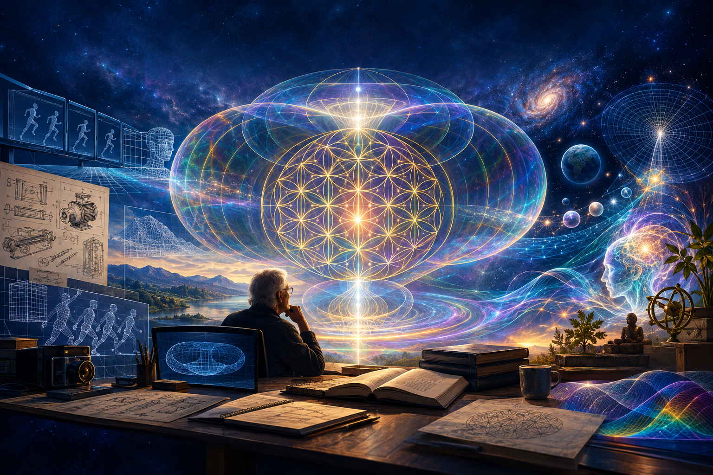

---

ChatGPT generated the image, here is it's comment:

> Leon H. Maurer was a technology inventor and interdisciplinary consciousness theorist whose work explored connections between unconditioned consciousness, infinite information, potential energy, time, and the origin of the universe.
>
> This illustration brings together his technological background and speculative cosmology through the Flower of Life, sacred geometry, holographic fields, engineering, consciousness, and the cosmos. It presents these ideas as theoretical explorations rather than established physics.

I must also mention I do not agree on all his work, but I see kind of depth there - to study the topic definitely means to study him.

---

To study flower of life, logos, "god's particle", one can study:
- https://theosophy.net/profile/LeonMaurer
- Leon Maurer

I was in Science of Consciousness list some 90 years ago with his active participiation; he died at 90 when I was member of the list.

His life story:
- Technology, various patents.
- First man to take photograph of concentration camp.
- Studied various topics associated with jewish religion.

---

https://jcer.com/index.php/jcj/article/view/85
- How Unconditioned Consciousness, Infinite Information, Potential Energy, and Time Created Our Universe
- https://scireprints.lu.lv/145/ - actually openable

An e-mail:
- https://groups.io/g/Theosophy/topic/37520526

You can study further.
